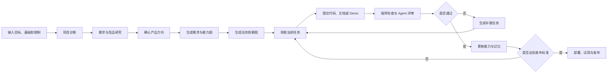
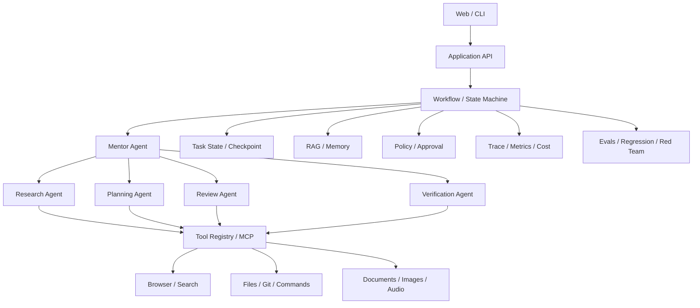

# CraftLab：项目制学习 Agent

## 1. 产品分析

### 1.1 产品是什么

CraftLab 是一个项目制学习 Agent。用户选择希望掌握的技术方向后，产品负责确定真实项目、拆分学习任务、检查项目产物、记录能力变化，并推动项目达到发布标准。

产品管理的核心对象不是聊天消息，而是以下可持久化数据：

| 核心对象 | 内容 |
| --- | --- |
| 学习项目 | 用户目标、产品范围、总工时和发布标准 |
| 产品需求 | 目标用户、使用场景、功能、指标和边界 |
| 能力图谱 | 产品需求与所需知识、技能、工程能力的映射 |
| 任务图 | 任务依赖、操作、产物、验收和状态 |
| 项目产物 | 代码、文档、测试、Demo、截图和运行记录 |
| 能力证据 | 评审结果、错误模式、迁移任务和掌握状态 |

### 1.2 产品功能组成

| 功能模块 | 主要职责 | 用户可见结果 |
| --- | --- | --- |
| 项目诊断 | 分析技术基础、目标、限制和已有能力 | 结构化能力档案 |
| 需求研究 | 调查真实需求、竞品和可实现性 | 带来源的产品候选方案 |
| 产品确认 | 比较方案、修改范围并冻结需求 | 确认后的产品需求 |
| 任务规划 | 从产品功能生成能力图和任务依赖图 | 可执行 Checklist |
| 项目导师 | 提供当前任务所需的最少知识和操作提示 | 任务说明与针对性辅导 |
| 工作区评审 | 检查代码、文档、Git、测试和运行结果 | 有证据的评审报告 |
| 动态补救 | 将失败原因转成最小返工任务 | 补救任务与再次验收 |
| 学习记忆 | 记录进度、决策、能力证据和错误模式 | 跨会话学习档案 |
| 质量系统 | 执行 Evals、Trace、安全和成本检查 | 版本质量与风险报告 |
| 发布支持 | 完成部署、试用、回滚和失败回灌 | 可运行版本与发布报告 |

### 1.3 目标用户

首要用户是具备基础编程能力、希望系统掌握 Agent 工程的开发者，具体特征包括：

- 能够阅读和编写基础 Web、CLI 或 API 项目。
- 使用过大模型、聊天助手或 Coding Agent。
- 了解 Prompt、Tool、RAG 等概念，但缺少系统工程经验。
- 需要通过真实产品和验证证据证明能力。

扩展用户包括技术导师、团队培养负责人和项目制课程作者。

### 1.4 解决的问题

| 用户问题 | CraftLab 的解决方式 |
| --- | --- |
| 不知道应该做什么产品 | 调研需求和竞品，提供有来源的候选方向 |
| 学习内容零散 | 从产品功能反推能力图谱 |
| 计划无法执行 | 生成具有依赖、产物和验收的任务图 |
| 无法判断是否真正掌握 | 同时检查实现、测试、解释和迁移能力 |
| Agent 容易替用户完成任务 | 限制 Agent 帮助范围，保留学习者核心实现责任 |
| 多次会话后进度丢失 | 保存能力证据、错误模式和用户决策 |
| Demo 无法进入生产 | 加入评测、安全、可观测、部署和回滚要求 |

### 1.5 核心使用场景

| 场景要素 | 内容 |
| --- | --- |
| 前置条件 | 用户具备基础编程能力，并授权一个本地项目目录 |
| 初始信息 | 技术基础、学习目标、总工时、成本限制和发布要求 |
| 触发 | 用户创建学习项目 |
| 主流程 | 项目诊断 → 需求研究 → 产品确认 → 任务执行 → 产物评审 → 补救返工 → 发布 |
| 产品输出 | 产品需求、能力图、任务图、评审记录、能力档案和发布报告 |
| 成功结果 | 用户独立完成可发布产品，并通过未见需求的迁移测试 |

### 1.6 核心用户旅程



---

## 2. 需求范围与验证

### 2.1 产品目标

#### P0：核心闭环

- 完成用户能力、目标和限制诊断。
- 基于真实需求提出并确认产品方向。
- 生成产品需求、能力图谱和任务依赖图。
- 为每个任务定义操作、产物和验收标准。
- 在授权范围内读取代码、文档、Git 状态和测试结果。
- 使用确定性检查与语义评审评价产物。
- 根据失败证据生成最小补救任务。
- 记录进度、错误模式、能力证据和用户决策。

#### P1：完整 Agent 工程能力

- 接入标准工具协议 MCP。
- 支持 Research、Browser、Workspace 和 RAG。
- 支持短期记忆、长期记忆和个性化。
- 支持 Human-in-the-loop 与风险审批。
- 支持多 Agent、A2A 和上下文隔离。
- 支持文档、图片、图表和音频。
- 支持长任务、计划任务和事件驱动任务。
- 支持 Evals、Trace、成本控制、故障恢复和安全治理。

#### P2：产品化

- 提供最小可用的 Web 产品界面。
- 支持本地运行和容器部署。
- 支持健康检查、版本门禁和回滚。
- 支持真实失败回灌评测集。
- 形成可公开安装和体验的版本。

### 2.2 非目标

- 不训练基础大模型。
- 不覆盖机器人控制和具身智能。
- 不穷举所有 Agent 框架、模型供应商和向量数据库。
- 不建设与核心学习闭环无关的复杂前端功能。
- 不允许 Agent 无审批执行删除、发布、付费或外部发送。
- 不使用聊天记录直接充当可靠的长期记忆。
- 不以生成内容数量代替学习效果。

### 2.3 需求假设

| 编号 | 假设 | 验证方式 | 通过标准 |
| --- | --- | --- | --- |
| H-01 | 项目制路径比固定知识章节更具吸引力 | 用户访谈与原型选择 | 目标用户选择项目制路径的比例不低于 70% |
| H-02 | 用户愿意授权受限的本地工作区读取权限 | 权限原型测试 | 接受只读授权的用户比例不低于 60% |
| H-03 | 明确产物和验收标准能够提高完成率 | 对照测试 | 任务完成率提升不低于 20% |
| H-04 | 基于失败证据生成补救任务能够提高掌握度 | 前后测对比 | 终测结果提升不低于 15% |
| H-05 | 长期记忆和持续评审能够提高留存 | 连续试用观察 | 观察周期末活跃率不低于 40% |

### 2.4 关键失败场景

- 未调查需求便生成产品方向和学习任务。
- 任务只有知识名称，没有真实操作和产物。
- 任务产物存在，但内容未经程序检查和语义评审。
- Agent 完成全部核心实现，学习者无法解释关键决策。
- 评审完全依赖模型主观打分，没有稳定测试证据。
- 会话结束后丢失学习进度、决策和错误模式。
- 工具调用缺少权限控制、结果验证和审计。
- 长任务中断后从头执行，产生重复成本或副作用。
- 网页、文档或仓库内容通过 Prompt Injection 获取额外权限。
- 模型、Prompt 或工作流升级后缺少回归评测。

### 2.5 成功指标

#### 学习结果

- 正式任务具备产物和验收标准的比例为 100%。
- 学习者亲自完成核心设计与实现的任务比例不低于 80%。
- 学习者能够解释关键架构决策及其替代方案。
- 学习者能够独立完成一个未见过的小型 Agent 需求。

#### Agent 质量

- 有来源要求的研究结论引用覆盖率为 100%。
- 结构化输出有效率不低于 98%。
- 评审 Agent 与人工标注的一致率不低于 85%。
- 高风险副作用的人工确认覆盖率为 100%。
- 长任务故障恢复成功率不低于 95%。
- 版本升级不得突破核心评测集的退化阈值。

---

## 3. 产品需求

### 3.1 功能需求

| 编号 | 优先级 | 功能 | 验收结果 |
| --- | --- | --- | --- |
| FR-01 | P0 | 用户诊断 | 生成带证据和不确定项的结构化能力档案 |
| FR-02 | P0 | 需求研究 | 市场判断包含来源、时间和置信度 |
| FR-03 | P0 | 产品确认 | 用户确认前不生成正式任务图 |
| FR-04 | P0 | 需求分析 | 输出用户、场景、范围、指标和非目标 |
| FR-05 | P0 | 能力图谱 | 每个产品需求映射到工程能力 |
| FR-06 | P0 | 任务图 | 任务依赖无循环，且具备产物和验收标准 |
| FR-07 | P0 | 工作区读取 | 只读取用户明确授权的目录和文件 |
| FR-08 | P0 | 产物评审 | 同时使用程序检查、测试结果和语义评审 |
| FR-09 | P0 | 动态补救 | 根据失败原因生成最小补救任务 |
| FR-10 | P0 | 学习记忆 | 保存进度、错误模式、能力证据和用户决策 |
| FR-11 | P0 | 任务状态 | 支持待开始、进行中、待评审、返工、完成和阻塞 |
| FR-12 | P0 | 人工控制 | 支持暂停、修改、跳过和回退任务 |
| FR-13 | P0 | 权限审批 | 写入、命令和外部操作按风险分级 |
| FR-14 | P0 | 过程证据 | 结论可追溯到来源、工具结果、文件或测试 |
| FR-15 | P1 | 多模态产物 | 支持文档、截图、图表和录音评审 |
| FR-16 | P1 | 多 Agent | 支持研究、规划、辅导、评审和验证协作 |
| FR-17 | P1 | 长任务 | 支持检查点恢复，且不重复副作用 |
| FR-18 | P1 | 主动任务 | 支持提醒、复盘和停滞检测 |
| FR-19 | P1 | 可观测性 | 记录 Trace、工具调用、成本、延迟和结果 |
| FR-20 | P1 | 评测系统 | 支持固定数据集、回归对比和版本门禁 |
| FR-21 | P1 | 自我改进 | 真实失败进入评测集后才能修改工作流 |
| FR-22 | P1 | 部署 | 支持本地和云端运行、健康检查与回滚 |

### 3.2 非功能需求

| 维度 | 要求 |
| --- | --- |
| 正确性 | 关键结论必须有证据，模型自述不能作为完成证明 |
| 可解释性 | 用户能够查看任务原因、评分依据和失败原因 |
| 安全性 | 最小权限、工具白名单、危险动作确认和完整审计 |
| 隐私 | 本地优先，支持查看、导出和删除用户数据 |
| 可靠性 | 支持超时、重试、幂等、检查点、降级和恢复 |
| 可移植性 | 模型、向量库和工具不绑定单一供应商 |
| 成本 | 每个任务具备预算，超出预算时停止执行 |
| 可测试性 | Prompt、工具、记忆、路由和工作流可离线回放 |
| 可访问性 | 核心操作支持键盘，状态和错误不只依赖颜色表达 |

---

## 4. Agent 能力覆盖矩阵

覆盖范围为生产级软件 Agent 的核心工程场景，不包括基础模型训练、机器人控制和具体行业知识。

| Agent 场景 | CraftLab 中的实现 | 学习任务 | 验收证据 |
| --- | --- | --- | --- |
| 对话 Agent | 诊断目标、解释任务和处理追问 | C2、C3 | 多轮对话测试 |
| 结构化输出 | 能力档案、需求、任务和评分结果 | C2 | Schema 验证 |
| Planning | 从产品目标生成能力图与任务图 | C3 | 无循环任务 DAG |
| Agent Loop | Observe、Plan、Act、Verify、Stop | C3 | 可回放执行轨迹 |
| Workflow Agent | 确定性流程与模型判断混合编排 | C3 | 状态与失败路径测试 |
| Tool Use | 搜索、文件、Git、命令和通知工具 | C4 | 工具契约与集成测试 |
| Browser Agent | 访问页面并提取可验证证据 | C4 | 浏览轨迹与页面证据 |
| Workspace Agent | 检查代码、文档和测试 | C4 | 授权记录与评审报告 |
| MCP | 标准化接入外部工具与资源 | C4 | MCP 客户端与服务端 |
| Research Agent | 调研需求、竞品和资料 | C5 | 来源覆盖评测 |
| Grounding | 将事实结论绑定来源 | C5 | 引用一致性测试 |
| RAG | 检索课程、文档和历史产物 | C5 | 检索相关性评测 |
| Context Engineering | 选择、压缩和组装模型上下文 | C5 | 上下文对照测试 |
| 短期记忆 | 保持任务和会话状态 | C6 | 会话回放测试 |
| 长期记忆 | 保存能力、错误、决策和偏好 | C6 | 跨会话与删除测试 |
| 个性化 Agent | 根据能力和错误调整任务 | C6 | 用户路径对比 |
| Human-in-the-loop | 产品确认、任务修改和危险动作审批 | C7 | 审批覆盖测试 |
| Agent 安全 | 防注入、越权、工具投毒和泄密 | C7 | 威胁模型与红队结果 |
| 多租户隔离 | 隔离用户数据、任务和记忆 | C7 | 越权访问测试 |
| Evals | 数据集、评分器、回归和红队 | C8 | 版本对比报告 |
| Observability | Trace、日志、指标、成本和错误聚类 | C8 | 可观测报告 |
| Model Routing | 按质量、成本和延迟选择模型 | C8 | 路由对照实验 |
| 可靠执行 | 超时、重试、熔断、缓存和降级 | C8、C11 | 故障注入报告 |
| 多 Agent | 研究、规划、评审和验证协作 | C9 | 单 Agent 对照实验 |
| Agent-to-Agent | 任务委派、状态同步和结果交接 | C9 | 消息契约测试 |
| 多模态 Agent | 处理文档、图片、图表和音频 | C10 | 多模态评测集 |
| 长时间运行 | 大型调研和全仓评审 | C11 | 中断恢复测试 |
| 主动 Agent | 提醒、复盘和停滞检测 | C11 | 调度与通知测试 |
| 事件驱动 Agent | 响应文件、Git、Webhook 和任务事件 | C11 | 事件去重测试 |
| 自我改进 | 将真实失败回灌评测并控制升级 | C12 | 失败到发布证据链 |
| 部署与运维 | 部署、健康检查、灰度和回滚 | C12 | 部署与恢复记录 |

---

## 5. 产品架构

### 5.1 架构原则

- 确定性工作流负责状态、权限、预算和关键规则。
- Agent 负责搜索、规划、解释和语义判断等不确定任务。
- 每个 Agent 只获得完成当前任务所需的最小上下文和工具。
- 执行 Agent 与评审 Agent 分离，关键结果再经过确定性验证。
- 工具具备明确 Schema、权限、错误类型和结果验证。
- 长任务具备任务 ID、检查点和幂等键。
- 记忆区分事实、推断、偏好、决策和过期信息。
- Prompt、模型、工具和工作流版本均可追溯。

### 5.2 逻辑架构



### 5.3 技术基线

| 层 | 技术基线 |
| --- | --- |
| Agent 服务 | Python |
| API 与 Schema | FastAPI、Pydantic |
| Web | 最小 React 或服务端页面 |
| 数据存储 | SQLite |
| 模型层 | 统一 Model Gateway、一个主模型、一个 Mock |
| 工具协议 | JSON Schema、MCP |
| 检索 | Embedding、关键词检索、重排 |
| 可观测 | 结构化 Trace、日志和指标 |
| 评测 | pytest、自定义 Eval Runner |
| 部署 | Docker Compose |

---

## 6. 能力验收标准

每项学习任务从四个维度验收：

| 维度 | 要求 | 证据 |
| --- | --- | --- |
| 原理 | 说明解决的问题、工作原理、适用边界和替代方案 | 设计说明或闭卷问答 |
| 实现 | 在 CraftLab 主链路中完成最小实现 | 代码、运行记录和实际产物 |
| 验证 | 覆盖正常、边界和失败情况 | 测试、Eval 或故障记录 |
| 迁移 | 将能力用于未见过的小型需求 | 独立迁移任务 |

任务完成条件：

- Checklist 中的子项全部完成。
- 产物真实存在并属于当前版本。
- 自动检查和必要测试通过。
- 关键设计能够独立解释。
- 失败和返工已经记录。
- 不存在未记录的高风险问题。
- 后续任务所需输入已经形成。

以下情况不能判定为完成：

- 只有模型生成的完成声明，没有验证证据。
- 只有代码，没有运行记录或测试。
- 只有设计文档，没有对应实现。
- 复制示例后无法解释关键决策。
- 通过删除检查或绕过失败获得通过结果。
- 产物依赖未记录的手工步骤。

---

## 7. 学习任务 Checklist

### 7.1 工时预算

| 类型 | 工时 |
| --- | ---: |
| 原理与案例 | 10 小时 |
| 产品实现 | 28 小时 |
| 测试、Eval 与排错 | 7 小时 |
| 迁移、复盘与发布 | 3 小时 |
| **合计** | **48 小时** |

实施约束：

- 使用一套主技术栈和模块化单体架构。
- Agent 核心循环、工具注册、状态管理和评测流程由学习者实现。
- 模型调用、文档解析、数据库驱动等通用能力使用成熟库。
- 每项能力在产品主链路中实现一个代表性场景。
- 同一实现可以为多个能力提供验收证据。
- 总工时不得超过 50 小时。

### 7.2 Checklist

- [ ] **C1 需求分析与 Agent 边界（3 小时）**
  - [ ] 原理：掌握 Agent、Workflow、Chatbot、自治等级和场景判断。
  - [ ] 实现：分析至少 8 个真实案例和 4 个竞品，完成产品需求与 Agent 适用性决策表。
  - [ ] 产物：`docs/research.md`、`docs/prd.md`、10 条基线用例。
  - [ ] 验证：每个 P0 功能能够映射到真实需求和 Agent 使用理由。
  - [ ] 迁移：独立判断一个新需求应使用 Agent、工作流还是普通程序。

- [ ] **C2 模型与结构化交互（4 小时）**
  - [ ] 原理：掌握 Message、Token、Context、Prompt、Structured Output、Streaming 和模型成本。
  - [ ] 实现：完成 Model Gateway、Pydantic Schema、Prompt 版本和 Mock Provider。
  - [ ] 产物：模型网关、调用账本、结构化能力档案。
  - [ ] 验证：覆盖格式错误、超时、上下文超限和模型不可用。
  - [ ] 迁移：为一个新的结构化任务设计 Schema、Prompt 和失败策略。

- [ ] **C3 Agent Runtime 与 Planning（5 小时）**
  - [ ] 原理：掌握 Agent Loop、ReAct、Plan-and-Execute、状态机、停止条件、工作流和中断。
  - [ ] 实现：完成最小 Agent Runtime、任务 DAG 和 Human-in-the-loop 确认点。
  - [ ] 产物：可回放执行轨迹、状态图和任务图。
  - [ ] 验证：覆盖无限循环、非法状态、用户中断和计划失败。
  - [ ] 迁移：为一个新的多步任务设计 Agent 与确定性流程的边界。

- [ ] **C4 Tools、Browser、Workspace 与 MCP（5 小时）**
  - [ ] 原理：掌握 Function Calling、工具契约、结果验证、Browser、Workspace 和 MCP。
  - [ ] 实现：完成 Tool Registry、搜索工具、文件/Git/命令工具、MCP 客户端与服务端。
  - [ ] 产物：工具 Schema、权限矩阵、调用轨迹和 MCP Demo。
  - [ ] 验证：覆盖参数错误、路径穿越、未授权命令、超时和错误结果。
  - [ ] 迁移：独立接入一个新的外部工具并定义安全边界。

- [ ] **C5 Research、Grounding、RAG 与 Context（4 小时）**
  - [ ] 原理：掌握搜索、引用、Chunk、Embedding、混合检索、重排和上下文组装。
  - [ ] 实现：完成 Research Pipeline、来源模型、RAG 索引和 Context Builder。
  - [ ] 产物：有引用的竞品报告、至少 10 条检索用例和相关性报告。
  - [ ] 验证：覆盖无结果、冲突来源、错误引用和不可信检索内容。
  - [ ] 迁移：为一个新知识库选择切分、检索和重排策略。

- [ ] **C6 Memory 与个性化（3 小时）**
  - [ ] 原理：掌握工作记忆、情节记忆、语义记忆、程序记忆、冲突、过期和遗忘。
  - [ ] 实现：完成 Memory Store、学习者能力档案和跨会话召回。
  - [ ] 产物：记忆模型、能力证据和记忆管理接口。
  - [ ] 验证：覆盖冲突记忆、错误记忆、过期信息、导出和删除。
  - [ ] 迁移：为一种新的用户偏好设计记忆生命周期。

- [ ] **C7 HITL、权限与 Agent 安全（4 小时）**
  - [ ] 原理：掌握指令层级、Prompt Injection、工具投毒、沙箱、秘密、审批、审计、隔离和隐私。
  - [ ] 实现：完成 Policy Engine、风险分级、审批流和审计日志。
  - [ ] 产物：威胁模型、权限矩阵和红队用例。
  - [ ] 验证：不可信内容不能提权，高风险操作人工确认覆盖率为 100%。
  - [ ] 迁移：为一个具有外部副作用的新工具制定权限和审批策略。

- [ ] **C8 Evals、可观测、可靠性与成本（5 小时）**
  - [ ] 原理：掌握 Eval 数据集、确定性评分、模型评分、Trace、指标、重试、熔断、缓存、路由和降级。
  - [ ] 实现：完成 Eval Runner、30 条用例、评分器、Trace 和 Model Router。
  - [ ] 产物：版本对比、成本报告和故障注入报告。
  - [ ] 验证：能够复现失败、比较版本并阻止明显退化。
  - [ ] 迁移：为一个新的 Agent 功能建立评测集和发布阈值。

- [ ] **C9 多 Agent 与 A2A（3.5 小时）**
  - [ ] 原理：掌握角色边界、Supervisor、委派、上下文隔离、消息协议、并发和单/多 Agent 取舍。
  - [ ] 实现：完成研究 Agent 与验证 Agent 的协作链和 A2A 消息 Schema。
  - [ ] 产物：角色契约、委派轨迹和单/多 Agent 对照报告。
  - [ ] 验证：子任务超时或失败不会破坏主任务。
  - [ ] 迁移：根据质量、成本和延迟判断新场景是否需要多 Agent。

- [ ] **C10 多模态 Agent（3 小时）**
  - [ ] 原理：掌握文档、图片、图表和音频的提取、定位、统一产物与评测。
  - [ ] 实现：完成多模态 Artifact 模型和四类输入处理链。
  - [ ] 产物：处理轨迹、定位信息和多模态评测集。
  - [ ] 验证：结论能够定位原始页码、图像区域或音频时间段。
  - [ ] 迁移：为一种新的媒体输入设计解析、引用和失败策略。

- [ ] **C11 长任务、主动与事件驱动（3.5 小时）**
  - [ ] 原理：掌握 Durable Job、Checkpoint、幂等、补偿、Schedule、Webhook、事件去重和通知。
  - [ ] 实现：完成可恢复 Job、调度器、事件处理器和通知规则。
  - [ ] 产物：Job 状态模型、恢复记录和事件轨迹。
  - [ ] 验证：重启、重试和重复事件不会产生重复副作用。
  - [ ] 迁移：为一个新的长任务设计恢复、补偿和通知策略。

- [ ] **C12 产品集成、部署与自我改进（5 小时）**
  - [ ] 原理：掌握 Agent UX、部署、健康检查、灰度、回滚和失败回灌。
  - [ ] 实现：集成任务领取、产物提交、混合评审、补救、部署和发布。
  - [ ] 产物：可运行产品、部署记录、发布报告和 v1.0 版本。
  - [ ] 验证：外部用户能够完成核心旅程，全部场景具备验证证据。
  - [ ] 迁移：独立完成一个未见过的小型 Agent 需求，并将失败加入回归集。

---

## 8. 最终产物

```text
README.md                         产品需求与学习任务书
docs/
  research.md                     需求证据与竞品研究
  prd.md                          产品需求与用户旅程
  architecture.md                 Agent、工具、记忆与部署设计
  threat-model.md                 威胁模型与红队结果
  learning-review.md              决策、失败、迁移任务与复盘
app/
  api/                            FastAPI 接口
  web/                            最小产品界面
  agent/                          Runtime、角色与工作流
  tools/                          工具、Browser 与 MCP
  retrieval/                      RAG、Context 与 Memory
  policy/                         HITL、权限与安全
  jobs/                           长任务、计划与事件
  observability/                  Trace、指标与成本
evals/
  dataset.*                       正常、边界与对抗用例
  scorers/                        确定性与语义评分器
  release-report.md               版本对比与发布结论
tests/
  unit/
  integration/
  security/
deploy/
  compose.yaml
```

最终可展示成果：

- 可公开访问或本地安装的 CraftLab 产品。
- 一条完整且可回放的学习任务轨迹。
- 一套固定 Agent 评测集和版本对比报告。
- 一份 Agent 安全威胁模型和红队结果。
- 一份成本、延迟和可靠性报告。
- 一次公开版本发布和真实用户反馈。

---

## 9. 阶段闸门

- [ ] **G1：需求冻结**
  - [ ] 需求证据、用户场景、产品范围和基线用例完成。
  - [ ] P0 功能能够映射到真实需求。

- [ ] **G2：核心闭环**
  - [ ] 从产品确认到任务评审的主链路可运行。
  - [ ] 工具、RAG、记忆和权限具备验证证据。

- [ ] **G3：生产能力**
  - [ ] 多 Agent、多模态、长任务、事件任务和可观测能力完成。
  - [ ] 核心安全、红队和故障恢复测试通过。

- [ ] **G4：发布**
  - [ ] 外部用户完成核心旅程。
  - [ ] Agent 能力覆盖矩阵全部具有验收证据。
  - [ ] 独立迁移任务通过。
  - [ ] 部署、健康检查和回滚验证通过。

---

## 10. 风险与控制

| 风险 | 影响 | 控制措施 |
| --- | --- | --- |
| 产品范围过大 | 无法在工时预算内形成发布版本 | 使用模块化单体和代表性集成场景 |
| Agent 替代学习者完成任务 | 无法形成真实能力 | 核心设计、实现和迁移任务由学习者完成 |
| 多 Agent 过早复杂化 | 成本和调试难度上升 | 先建立单 Agent 基线，再进行对照实验 |
| LLM Judge 偏差 | 产生错误评价 | 使用确定性评分、人工校准和盲测 |
| 记忆污染 | 长期提供错误指导 | 记录来源、置信度、冲突和过期时间 |
| 工具越权 | 损坏文件或泄漏数据 | 沙箱、白名单、审批和审计 |
| 长任务重复执行 | 产生重复成本和副作用 | 检查点、幂等键和补偿操作 |
| 模型成本失控 | 产品无法持续运行 | 预算、路由、缓存、压缩和暂停 |
| 框架依赖过重 | 只掌握框架 API | 自行实现最小 Runtime 后再使用成熟框架 |
| 缺少真实验证 | 产品停留在 Demo | 真实用户、固定评测、部署和发布闸门 |
