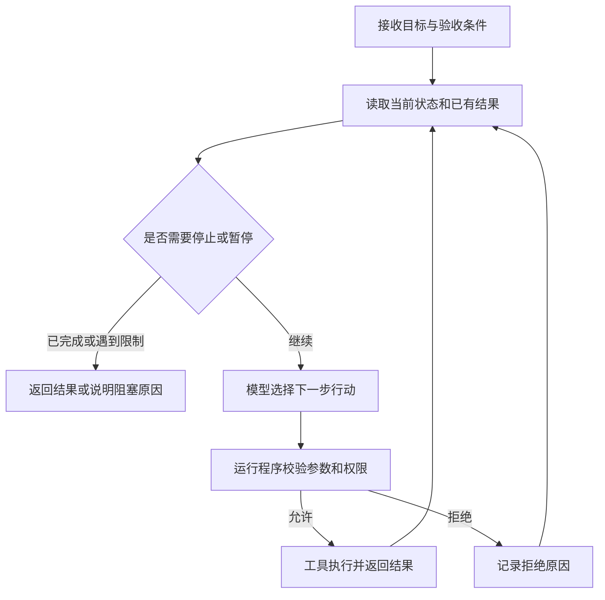

# 第一篇 什么是 Agent

在大模型应用中，Agent（智能体）通常指这样一类系统：它围绕一个目标，根据当前信息决定下一步行动，通过工具获取信息或执行操作，再根据结果继续推进任务。

例如，你刚写完一个待办事项应用，希望有人检查它是否达到了学习任务的要求。一个只接收文字的问答程序，可以解释如何检查；一个获得工作区访问权限的 Agent，则可以读取任务说明、查看代码、运行允许的测试，并根据发现的问题决定还需要检查什么。

这篇文章讨论的是以大语言模型（LLM）参与决策的软件 Agent。Agent 一词的用法并不统一；这里采用一个便于工程实践的区分：预先编排执行路径的是工作流，由模型根据执行情况动态决定部分路径的是 Agent。这与 Anthropic 在 [Building effective agents](https://www.anthropic.com/research/building-effective-agents) 中的区分一致。

## 从一次代码评审理解 Agent

假设我们要为 CraftLab 设计一个学习任务评审功能。学习者提交了待办事项应用，验收要求包括：能够新增任务、切换完成状态，以及刷新页面后仍能保留数据。

交给评审 Agent 的目标可以写成：

> 检查这个项目是否满足三条验收要求，给出证据和需要补做的内容。允许读取项目文件，并在隔离环境中运行指定测试、用浏览器验证功能；修改代码由学习者完成。

一次可能的执行过程如下：

1. Agent 读取任务说明和项目目录，发现项目里有测试文件。
2. 它查看测试内容，发现现有测试只覆盖了新增任务和状态切换。
3. 它调用测试工具，得到这两项通过的结果。
4. 由于数据持久化还没有得到验证，它继续查看数据保存和初始化的实现。
5. 它发现刷新后数据可能丢失，再通过获准使用的浏览器工具验证这一判断。
6. 它交付评审结果：前两项通过，第三项未通过，并附上复现步骤和补做要求。

第四步说明了 Agent 在这里的作用。测试通过之后，系统还需要结合任务要求判断证据是否足够。这个判断会影响后续操作：继续读代码、打开浏览器，或者在工具不足时报告某一项尚未验证。

换一个项目，后续路径也可能变化。如果项目没有测试，Agent 就需要寻找其他验证方式；如果运行环境不可用，它应记录阻塞原因。把这些选择交给模型处理，就需要给它明确的目标、可用工具和执行边界。

## Agent 如何持续执行

在上面的例子中，Agent 多次重复了同一个过程：读取当前信息，选择行动，取得结果，再判断下一步。这个过程常被称为 Agent Loop。

模型、工具和运行程序在这个循环中承担不同职责。

**模型负责提出下一步。** 它接收目标、工具说明和已有结果，生成回答或工具调用请求。例如，选择读取保存待办数据的文件，并给出文件路径。

**工具负责与环境交互。** 读取文件、查询数据库、执行测试和操作浏览器，都需要相应的执行能力。模型生成一段测试命令，并不代表测试已经运行；必须由工具执行，才能取得退出状态和输出。

**运行程序负责组织执行。** 它调用模型，检查工具请求，执行获准的操作，把结果放回后续上下文，并管理次数、时间和任务状态。模型提出一个操作请求，也不意味着这个请求必然会被执行。

循环中的反馈会改变后续选择。ReAct 是相关的代表性方法：将推理与行动交替组织，让行动取得的外部信息参与后续判断。它提供了一种实现思路，Agent 还可以采用其他组织方式。参见 [ReAct 论文](https://arxiv.org/abs/2210.03629)。

对于 CraftLab 的评审功能，我们可以设置具体的停止条件：验收项都有结论和证据、缺少完成检查所必需的权限、执行预算用尽，或者学习者主动中断。缺少某项证据时，评审结果应标明该项尚未验证。

## Agent 与聊天助手和工作流的关系

聊天描述的是交互方式，工作流和 Agent 描述的是系统如何组织执行。一个聊天窗口背后可以运行 Agent；一个没有聊天窗口的后台任务也可以采用 Agent。

用同一个学习项目，可以比较几种实现：

| 实现 | 具体行为 | 执行方式 |
| --- | --- | --- |
| 单次模型问答 | 根据贴出的代码解释可能的问题 | 应用调用一次模型，返回回答 |
| 固定工作流 | 读取提交、运行指定测试、让模型总结结果 | 开发者预先定义步骤和分支 |
| Agent | 根据验收要求与检查结果，决定继续读哪些文件、做哪些验证 | 模型在程序允许的范围内动态选择后续行动 |

工作流可以包含模型调用、条件分支和重试，也可以做得很复杂。只看系统是否循环、是否使用大模型，无法完成这个区分。对于一个具体设计，需要检查执行路径中哪些决定由代码预先规定，哪些决定交给模型。

比如，每次提交后都运行同一组测试，并生成一份结果摘要，这个需求很适合固定工作流。接入文件工具和测试工具，并不要求同时引入动态规划。

如果目标是诊断未通过验收的原因，后续需要读什么文件、查什么资料，往往取决于刚刚得到的结果。我们可以让 Agent 处理这部分调查，再由程序按既定规则保存报告和更新任务状态。一个产品可以同时使用这两种方式。

## 一个小型 Agent 需要准备什么

以评审功能为例，开始实现前可以先回答以下问题：

| 要素 | 需要明确的内容 |
| --- | --- |
| 目标与验收条件 | 要检查哪几项能力，什么证据足以支持结论 |
| 上下文与任务状态 | 当前项目是什么，哪些内容已检查，哪些仍缺证据 |
| 模型 | 根据这些信息选择下一步行动，并解释检查结果 |
| 工具 | 能读取什么文件，能运行哪些测试，能访问哪些页面 |
| 运行控制 | 如何校验请求、处理失败，以及何时停止或交给人处理 |

有了这些内容，就可以尝试实现一个范围很小的评审 Agent。它不必一开始就具备多个角色、向量数据库或长期记忆。

任务执行期间，运行程序需要保留足够的信息，避免刚看过的测试结果在下一轮丢失。这属于当前任务的上下文与状态管理。跨会话记住学习者的错误模式，则是另一个需求，需要专门设计长期存储和读取方式。

同样，接入知识库能帮助系统找到资料，但不能单凭这一点判断它是否采用 Agent 架构。还需要看检索由谁触发、结果如何影响后续操作，以及系统怎样结束任务。

## 自主性要落实到具体操作

在评审场景中，允许系统自行选择要读的文件，与允许它修改源码，是两种不同的权限。自动生成补做建议，与自动把任务标记为通过，也应分开设计。

我们可以先给评审 Agent 一组有限的能力：读取授权目录、在隔离环境中运行指定测试、保存评审草稿。即使模型判断修改代码有助于通过验收，运行程序也应按照这个角色的职责拒绝修改请求。

这种限制与 CraftLab 的学习目标有关。学习者需要自己完成实现，评审 Agent 的职责是查找证据、指出问题和提供适量提示。若它直接完成全部修复，项目可能通过测试，却无法证明学习者掌握了相关能力。

结果验证也要区分不同层次。测试通过，可以证明相应用例在当时环境中通过；要判断学习者能否解释设计、能否完成类似需求，还需要问答或迁移任务。评审报告应把结论与各自的证据对应起来。

## 把概念用于 CraftLab 的设计

在 CraftLab 的规划中，任务状态流转的合法性检查、工时求和和必填字段校验都有明确规则，可以由普通程序处理。提交产物后运行固定检查，可以由工作流完成。诊断失败原因、根据新发现决定继续调查什么，则可以尝试交给 Agent。

这样划分后，第一版评审功能的范围就比较清楚了：接收任务要求和项目路径，在授权范围内收集证据，输出每条要求的检查结论，以及需要学习者补做的内容。

动手实现之前，可以先写出两条执行路径：一条是项目已有完整测试且全部通过，另一条是测试通过但遗漏了数据持久化要求。在每一步旁边标注谁作决定、需要什么输入、会产生什么结果，以及什么情况下应该停下来。

把这两条路径保存为验收用例。实现后，检查 Agent 能否识别漏测项，并在工具不足时明确报告未验证内容。
